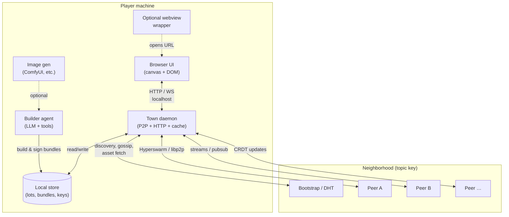
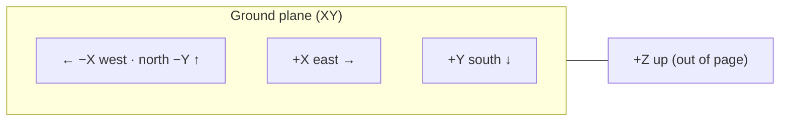

# Oh Machi — System Design

This document describes the intended architecture for Oh Machi (町): a decentralized, agent-assisted, cozy neighborhood simulator. It reflects the **design phase** (November 2026) and will change as prototypes teach us what works.

## Goals

- **Cozy shared town without a central game server.** Players meet in neighborhoods keyed by a topic (public name hash or invite-only secret). Gameplay data and assets flow peer to peer; optional bootstrap nodes only help with NAT traversal and DHT lookup.
- **Agent-built personalization.** Each player’s local AI agent produces pixel-art content under strict tooling constraints (grid, palette, lot boundaries). Humans approve or edit before publish.
- **Offline-friendly lots.** Neighbors cache and re-seed signed asset bundles so lots remain visitable when owners are offline.
- **Cryptographic identity, not accounts.** An Ed25519 keypair is the player, the publisher, and the signature on assets.
- **Linux-desktop-first, not Linux-only.** A small peer **daemon** (systemd user service) plus browser UI keeps Omarchy/Hyprland workflows simple; other platforms can run the same daemon and open the local URL.
- **Minimal dependencies.** Prefer small, inspectable libraries (Hyperswarm/HyperDHT, Yjs, Ed25519 signing). Avoid game engines and heavy UI frameworks.

## Non-goals (for early milestones)

- Massive concurrent worlds (MMO scale) or authoritative anti-cheat servers.
- **Game engines** (Godot, Unity, etc.) or Electron/Tauri as required parts of the stack — optional thin wrappers only.
- Mobile-first clients or app-store packaging (may come later).
- On-chain assets, NFTs, or cryptocurrency economies (in-world barter may exist; design TBD).
- Fully automated moderation without human or community input.
- Replacing image models with a single mandated provider (generators stay pluggable).

---

## Architecture overview

Oh Machi splits into four cooperating layers:

1. **Town daemon** — P2P networking, discovery, asset replication, CRDT sync, optional mDNS on LAN; **serves the UI** as static assets and a small local HTTP/WebSocket API (`http://127.0.0.1:…`).
2. **Browser UI** — Plain HTML/JS: neighborhood view, chat, publish flows. Opened in the user’s browser or an optional webview shell (Tauri/Electron/wv). No P2P in the browser tab — only talks to the daemon.
3. **Builder agent** — Local LLM + tools: constrained pixel editor, image-generation backends, sprite-stacking pipeline.
4. **Shared specifications** — Signed asset bundles, neighborhood manifest, CRDT document schemas.



**Neighborhood topic key.** A 32-byte value derived from either:

- **Public neighborhood:** `SHA-256("ohmachi/neighborhood/v1/" + normalized_name)` (name rules TBD to prevent squatting).
- **Private neighborhood:** random 32-byte secret shared out of band; only holders can derive the Hyperswarm/libp2p rendezvous key.

Peers discovering the same topic form an overlay. There is no global lobby server.

---

## Stack options and recommendations

The tables below summarize realistic choices verified against public docs and release activity as of late 2026. **Recommendations** favor the smallest path to Milestone 1 (see [MILESTONES.md](MILESTONES.md)); they are not final forever.

### Discovery and transport

| Option | What it provides | Current state (late 2026) | Fit for Oh Machi |
|--------|------------------|---------------------------|------------------|
| **Hyperswarm + HyperDHT** (Holepunch) | Topic-based peer discovery, UDP hole punch, encrypted streams | Active releases (`hyperswarm` 4.17.x, `hyperdht` 6.36.x per npm). Documented for Node/Bare. Open security issues on DHT (rate limits, handshake floods — see [holepunchto/hyperdht issues](https://github.com/holepunchto/hyperdht/issues)). | **Strong match** for topic-key neighborhoods and minimal ops. |
| **libp2p** (js-libp2p) | Modular transports (TCP, QUIC, WebRTC), Kad-DHT, GossipSub | Production use in IPFS/Ethereum; GossipSub v1.0–v1.2 implemented in JS. Browser needs WebRTC; desktop can use TCP/QUIC. More configuration surface. | **Good alternative** if we need Rust-side parity (`rust-libp2p`) or GossipSub mesh for many small messages. |
| **mDNS** | LAN peer discovery | Available in both ecosystems (multicast DNS). | **Supplement** for same-LAN play and dev; not sufficient alone for internet play. |

**Recommendation:** Start with **Hyperswarm** for Milestone 1 discovery and bilateral streams (simpler API, topic keys map directly to `discoveryKey`). Keep an **abstraction layer** in the daemon so we can add libp2p GossipSub later if neighborhood size or message patterns demand it. Run **2–3 community bootstrap nodes** (volunteer-operated, no game logic) plus mDNS on LAN.

**Risks:** HyperDHT is not a content network by itself; we still need a separate asset replication design. Recent DHT security research/reporting suggests hardened defaults (connection limits, size caps) before public launch.

### Realtime state (movement, chat, world metadata)

| Option | Model | Current state | Fit |
|--------|-------|---------------|-----|
| **Yjs** (+ custom or y-webrtc provider) | CRDT shared types (`Y.Map`, `Y.Array`) | Mature; `y-webrtc` uses mesh WebRTC with ~20–35 default max connections (configurable). | **Good for small neighborhoods** (tens of peers). Simple JS integration. |
| **Automerge 3** (+ automerge-repo) | JSON-like CRDT with full history | Rust/WASM core; peer networking via adapters (WebSocket sync server, community PeerJS adapter). Heavier bundle; rich versioning. | **Better later** for trade audit logs and conflict archaeology; more moving parts for pure P2P. |
| **Raw app messages over Hyperswarm streams** | Ad-hoc binary protocol | No CRDT guarantees. | Fine for **chat-only prototype**; insufficient for lot layout + economy without reinventing merge logic. |

**Recommendation:** **Yjs** for neighborhood world state in early milestones: player positions, chat lines, lot registry pointers, day/weather sync. Namespace documents per neighborhood (`Y.Doc`). Wire the Yjs provider over **Hyperswarm duplex streams** (custom provider) rather than public y-webrtc signaling servers, to stay serverless. Re-evaluate **Automerge** when implementing signed trade ledgers that need per-change history.

**Risks:** Yjs mesh does not scale to hundreds of simultaneous movers in one neighborhood; product goal is cozy small towns, but we should document a soft cap (e.g. 32 concurrent) until we add relayed pubsub.

### Asset distribution

| Option | Addressing | Current state | Fit |
|--------|------------|---------------|-----|
| **Custom signed bundles** (see [ASSET_FORMAT.md](ASSET_FORMAT.md)) | Content hash of manifest (e.g. SHA-256) | N/A — our spec | **Recommended.** Clear ownership, cache-friendly, BitTorrent/Hypercore as transport only. |
| **Hyperdrive / Hypercore** | Log keyed by writer public key; Hyperblobs IDs are **positional**, not content hashes | Hypercore 10 LTS; Hyperdrive v13 docs on pears.com | Useful as **transport/replication** for a lot’s append-only updates; manifest still should be content-addressed. |
| **BitTorrent + BEP 46** | Info hash + optional mutable `dmhy` payload | Widely deployed; mutable torrents need careful trust model | Fallback for **large archival** seeding; verify signatures outside BitTorrent layer. |

**Recommendation:** Treat **content-addressed signed bundles** as the source of truth. Peers fetch by manifest hash over Hyperswarm (`hypercore` replication or simple hash-announce + request/response). Neighbors **pin** bundles they care about (adjacent lots, friends) and advertise availability in a CRDT map: `lot_id → { manifest_hash, publisher_pubkey }`.

### Client shell (browser-first)

| Approach | Role | Notes |
|----------|------|--------|
| **Any browser → local URL** | Default UX | User runs daemon; opens `http://127.0.0.1:<port>/`. Works on Omarchy and elsewhere with zero extra packages. |
| **Optional webview wrapper** | Convenience | Minimal Tauri/Electron/embedded webview that only loads the local URL (no second app logic). Not a project requirement. |
| **Godot / Unity / etc.** | — | **Out of scope.** Would fork the PNG/sprite-stacking pipeline and inflate dependencies. |

**Recommendation:** Ship **daemon + static `ui/`** as the product surface. Document a desktop file or shell alias (`ohmachi open`) that starts the daemon if needed and opens the default browser. Add a wrapper package only if users ask for one window chrome.

**Daemon runtime:** **Node or Bun** for Milestone 1 (Hyperswarm and Yjs are JS-native). Keep the dependency tree small; avoid bundling a browser inside the default install.

### Rendering: Canvas 2D vs three.js

Oh Machi’s fake-3D look matches **sprite stacking**: horizontal slice strips, pitch/squash, Y-ordered draws, optional normal/emissive strips and simple ground shadows — the same model as [sprite-stacking](https://github.com/danielwh2/sprite-stacking)’s reference viewer (software rasterizer, typed arrays, scene Y-sort).

| Criterion | Custom **Canvas 2D** | **three.js** (WebGL) |
|-----------|----------------------|----------------------|
| **Sprite-stacked slices** | Natural fit: `drawImage` per slice, nearest-neighbor scaling, direct port of stacking math | Renders as textures on planes; must fight `LINEAR` filtering for crisp pixels; scene graph heavier than needed |
| **Y-sorting / draw order** | Sort by `foot_y` then tie-break (see [Coordinate system](#coordinate-system)); one pass | `sortObjects` or manual render order; works but adds WebGL layer |
| **Lighting / time-of-day** | Per-slice or per-pixel tint from sun vector; emissive from companion strip (reference viewer pattern) | Real lights + shadow maps; powerful but easy to look “wrong” for pixel art; more shaders to maintain |
| **Ground shadows** | 2D projected footprint (reference uses flat squash projection) | Shadow maps — overhead for mostly-orthogonal pixel props |
| **Tile layers** | Straightforward grid blit | Possible with orthographic camera; still more setup |
| **Bundle size / deps** | **0** extra render libraries | Non-trivial npm payload + WebGL context lifetime |
| **When three.js wins** | — | Many moving stacked props + post-processing + true camera tilt **if** canvas profiling fails targets |

**Recommendation:** **Custom Canvas 2D renderer** for M1–M4, reusing the sprite-stacking approach (slice strip → stacked frames, unified Y-sort, optional normals/emissive). Treat **three.js as opt-in only** after a measured prototype: adopt it only if canvas cannot sustain the M4 target (~30 FPS with modest stacked prop counts on a laptop CPU) without unmaintainable code. Default dependency list should **not** include three.js.

### Image generation

Pluggable backends:

- **Local:** ComfyUI HTTP API with pixel-art checkpoints/LoRAs.
- **Remote:** User-supplied API keys (optional; not required for offline play).
- **Agent-only:** Deterministic Python/Pillow drawing when no GPU is available.

The agent never writes raw PNGs straight to the P2P layer without passing through palette/grid constraints and human-visible preview.

### Fake-3D props: sprite-stacking integration

[danielwh2/sprite-stacking](https://github.com/danielwh2/sprite-stacking) (MIT) converts **four orthographic views** (top, side, front, back) into a **horizontal strip of slice PNGs** for runtime fake-3D rendering, with optional normal and emissive strips.

**Proposed pipeline for Oh Machi:**

1. **Concept** — Image model or agent draws a 4-view sheet (1×4 row or 2×2 grid); optional palette reduction.
2. **Constrain** — Snap to neighborhood palette (`--colours N` in `views_to_slices.py`; default 24).
3. **Carve** — Run `views_to_slices.py` → `slices.png`, optional `--normals`, `--emissive`, `--preview`.
4. **Bundle** — Store strips in [asset bundle](ASSET_FORMAT.md) as `type: "sprite_stack"` with metadata: `slice_count`, `slice_width`, `slice_height`, `squash`, `layer_spacing`.
5. **Runtime** — Browser canvas reuses stacking math from the reference viewer (or pre-bakes 16-direction sheets via export tooling for performance).

**Flat tiles** (ground, fences, floor patterns) stay **2D tile layers** on a fixed lot grid; only props and avatars use sprite stacks.

**Risks:** Thin 1px features in views can “blink” when rotated (`thin_runs` warning in the slicer). Agent guidelines must enforce minimum 2px thickness for posts, antennas, etc.

---

## Identity

- **Key material:** Ed25519 keypair generated locally on first launch; secret key encrypted at rest with OS keyring (secret-service on Linux).
- **Player ID:** `z-base-32` or hex encoding of public key (format TBD; must appear in signatures and UI).
- **Display name:** Unsigned hint in CRDT (spoofable); UI shows pubkey fingerprint for verification.
- **Device linking:** Optional second device = second key; “trusted devices” list signed by primary (future).

No username registry, email, or OAuth.

---

## Discovery (detail)

1. Daemon joins neighborhood `topic_key`; browser UI connects to daemon API only.
2. **WAN:** HyperDHT bootstrap list (configurable; ship defaults, allow user override). Topic advertised as `discoveryKey = hash(topic_key)`.
3. **LAN:** mDNS service `_ohmachi._udp` with instance name = neighborhood id fingerprint (not full secret for private hoods).
4. Peers exchange: pubkey, supported protocol versions, manifest heads, Yjs state vector.

Invite flow for private neighborhoods: export `ohmachi://join?k=<base64url secret>` (no central server).

---

## Networking and realtime

**Channels (conceptual):**

| Channel | Payload | Priority |
|---------|---------|----------|
| **CRDT sync** | Yjs updates (world + chat) | Reliable, ordered per peer |
| **Asset requests** | Manifest hash → bundle blocks | Reliable, resumable |
| **Ephemeral** | Typing indicators, emotes | Lossy OK |

**Versioning:** Semver on wire protocol; incompatible majors refuse handshake.

**NAT:** Rely on hole punching (HyperDHT). Document that symmetric NAT or hostile networks may require manual port forward or community relay (relays see encrypted traffic only; no gameplay authority).

---

## Coordinate system

Oh Machi uses a **right-handed** world frame with **+Z up**. All neighborhood simulation, manifests, and CRDT player state share these axes. Field names in [ASSET_FORMAT.md](ASSET_FORMAT.md) match this section.

### Axes (world space)

| Axis | Direction | Screen mapping |
|------|-----------|----------------|
| **+X** | East | Increasing **to the right** on screen |
| **+Y** | South | Increasing **down** the screen (ground depth toward the camera) |
| **+Z** | Up | Height above the ground plane |

The **ground plane** is the XY plane at a reference elevation (per-lot `origin` Z, usually `0`). Walking and tile grids live on XY; jump, stacked slices, and rooftops add Z.



*(Diagram is schematic: north is **−Y**, south is **+Y**.)*

### Tiles and world units

- **Lot and tile indices** are integers `(tile_x, tile_y)` on the ground plane, **east and south** positive.
- **1 tile = 1 world unit** along X and Y unless a neighborhood doc says otherwise.
- **Pixel size** for art comes from `tile_size_px` (16 or 32) in bundles: one tile edge is drawn `tile_size_px` screen pixels at 1:1 zoom, before camera scale.
- A world position in continuous space uses tile coordinates plus fractions, e.g. center of tile `(4, 6)` → `(4.5, 6.5, foot_z)`.

### Height and sprite stacks

For a `sprite_stack` instance anchored at world `(x, y, z₀)` with manifest fields `layer_spacing` and `squash` (see [ASSET_FORMAT.md](ASSET_FORMAT.md)):

- Slice index `i` (0 = ground slice, **leftmost** in the horizontal PNG strip) sits at world height **`z = z₀ + i * layer_spacing`**.
- Stacking along **+Z** is the **default** (`stack_axis: "z"`).

**Optional render trick:** a client may treat `stack_axis: "y"` as extruding the same sprite along **+Y** (south), with a darkening tint per step, to fake thickness or a drop shadow on the ground. This does not change the baked strip; it is a **local drawing mode** only.

### Screen projection (canvas renderer)

Camera pitch is encoded by **`squash`** (0–1, same semantics as [sprite-stacking](https://github.com/danielwh2/sprite-stacking): lower = stronger “into the screen” tilt). Let `(x, y, z)` be a point in **world tiles**, and `s` = `squash`, `k` = `px_per_tile` (from zoom × `tile_size_px`).

**Projection** (before pan/center):

```
screen_x_px = k * x
screen_y_px = k * s * (y - z)
```

World **+X** moves right; larger **+Y** and larger **+Z** both move the draw position **up** on screen (north and up are toward smaller screen Y). Implementations add a constant `screen_base_y` per frame for centering the neighborhood view.

Stack drawing lifts each slice by `layer_spacing` in Z before projecting, then composites slices bottom-to-top (increasing `i`).

### Draw order (Y-sort)

Painters’ order uses the **foot** of each drawable (ground contact), not the top of the stack:

1. Primary key: **`foot_y`** (world tiles, south increases depth).
2. Tie-break (same `foot_y`): lower **`foot_x`** (west) first, then lower **`foot_z`**, then stable **`instance_id`**.

Draw **later** (more south / higher keys) **on top**. Avatar and prop hitboxes use the same foot point for sorting and overlap.

### Facing and rotation

- **`facing_deg`** is yaw in the ground plane, **counterclockwise** when viewed from **above** (+Z looking down).
- **`facing_deg = 0`** means the prop or avatar faces **+X (east)**.
- **`facing_deg = 90`** faces **+Y (south)**; **180** faces west; **270** faces north.

**16-direction sprite sheets** (`sprite_sheet` assets): frame `d` covers yaw `d * 22.5°` for `d ∈ {0,…,15}`, with `d = 0` = east. Optional manifest field **`facing_offset_deg`** rotates which baked frame counts as east (default `0`).

Runtime stacking may rotate slice strips continuously; pre-baked sheets snap to the nearest direction index.

### CRDT and manifests

- **`players.position`**: `{ x, y, z }` in world tiles (continuous floats allowed); `z` is feet height on the ground plane stack.
- **`players.facing`**: `facing_deg` as above.
- **`lot_placement.stack_instances[].foot_tile`**: integer tile `(x, y)` for the prop foot on the ground plane; **`foot_z`** for base elevation (default `0`).
- Neighborhood **`grid_cell_px`**: default pixels per tile for the hood; should match bundle `tile_size_px` unless scaling is explicit.

---

## World state

Logical state lives in a per-neighborhood **Y.Doc** (recommended):

| Shared type | Contents |
|-------------|----------|
| `lots` | Map: `lot_id → { owner_pubkey, manifest_hash, bounds, version }` |
| `players` | Map: `pubkey → { position: {x,y,z}, facing_deg, animation, last_seen }` |
| `chat` | Array of `{ id, author, text, ts }` (capped length; archive in local logs) |
| `hood_meta` | Name, palette id, grid size, semver rules |
| `blocks` | Map of blocked pubkeys (local preference replicated cautiously — see moderation) |

**Lot boundaries** are authoritative in the signed lot manifest; CRDT only stores **pointers** to manifests, not paint data. Prevents griefing by remote CRDT edits.

---

## Asset format and pipeline

See [ASSET_FORMAT.md](ASSET_FORMAT.md) for the bundle spec.

**Agent tooling interface (draft):**

- `palette.list` / `palette.validate_color`
- `canvas.create` (width, height, grid 16|32)
- `canvas.set_pixel`, `canvas.fill`, `canvas.stamp_sprite`, `canvas.export_views` (for sprite-stack input)
- `stack.build` (invoke slicer, return slice dimensions)
- `bundle.sign` (manifest + assets → content hash)
- `lot.publish` (daemon advertises new manifest)

Tools return previews (base64 PNG) for human approval in the client UI.

**2D vs 3D-ish:** Houses may combine a flat **tile footprint** (floor/walls on lot grid) with **sprite_stack** entries for roof, chimney, character.

---

## Offline persistence

- **Daemon store:** SQLite or LevelDB with manifest index, bundle blobs, replication ledger (who we fetched from).
- **Cache policy:** Always keep own lot; LRU for neighbors with pin override; configurable disk cap.
- **CRDT:** Persist Yjs updates locally; merge on reconnect.
- **Agent workspace:** Separate directory for WIP; only signed bundles hit `publish/`.

---

## Security and threat model

| Threat | Mitigation |
|--------|------------|
| Forged lot edits | Ed25519 signature on manifest; clients reject unsigned or wrong-key bundles for a lot |
| Painting over another lot | Lot bounds enforced in client; manifests address single `lot_id` owned by signer |
| Malicious bundle (zip bombs, exploits) | Size limits; PNG-only initially; no executable payloads in v1 |
| DHT / handshake abuse | Connection limits, timeouts, issue tracking on HyperDHT hardening |
| Chat spam | Rate limits local; block list; optional neighborhood invite-only |
| Agent prompt injection → offensive art | Human publish step; block/report; trusted publisher lists |
| Trade cheating | Deferred; will need signed offer/accept messages (likely Automerge or custom signed log) |

**Sandboxing:** Agent runs with file access scoped to workspace; no arbitrary shell unless user enables developer mode.

---

## Moderation (decentralized)

- **Block list:** Per-user pubkey blocks — hide assets and chat; not global ban.
- **Trusted publishers:** Optional neighborhood rule: only manifests signed by members of a quorum list (hard for public hoods).
- **Report bundle:** Export manifest hash + reason; peers may choose to subscribe to community blocklists (explicit opt-in, no phone-home by default).
- **NSFW / policy:** Agent system prompts + local classifier optional; **no central admin** in core design.

---

## Packaging (later)

- Arch **PKGBUILD** splitting **`ohmachi-daemon`** (includes `ui/` static files), **`ohmachi-agent`**, optional **`ohmachi-desktop`** (browser launcher only).
- **systemd user unit** for daemon at login; docs explain opening `http://127.0.0.1:…` or `ohmachi open`.
- Optional **Quickshell** widget for status (neighbors online, unread chat).
- **No** default dependency on Tauri, Electron, or Godot.

---

## Open questions

1. **Neighborhood size cap** — What concurrent peer count is “good enough” before requiring relays or sharded CRDT docs?
2. **Economy** — Barter only, neighborhood scrip, or no currency in v1?
3. **Lot allocation** — First-claim in CRDT vs signed genesis map from neighborhood creator?
4. **Hypercore per lot vs static bundles** — Append-only updates for building renovations vs immutable versioned manifests.
5. **Cross-platform daemon** — Stay Node/Bun or migrate core to Rust for one binary (without pulling in a game engine)?
6. **Canvas performance ceiling** — At what prop count does canvas force a three.js spike or baked sprite sheets?
7. **Legal / copyright** — Agent-generated art resembling existing IP; user education and per-hood rules.
8. **Bootstrap sustainability** — Who operates DHT bootstrap nodes long term?
9. **Private neighborhood leakage** — mDNS and DHT metadata that might fingerprint invite-only towns.

---

## References

- Holepunch: [Hyperswarm](https://github.com/holepunchto/hyperswarm), [HyperDHT](https://github.com/holepunchto/hyperdht), [Hypercore](https://github.com/holepunchto/hypercore)
- libp2p: [js-libp2p](https://github.com/libp2p/js-libp2p), [GossipSub spec](https://github.com/libp2p/specs/blob/master/pubsub/gossipsub/README.md)
- Yjs: [yjs](https://github.com/yjs/yjs), [y-webrtc](https://github.com/yjs/y-webrtc)
- Automerge: [automerge-repo](https://github.com/automerge/automerge-repo)
- Sprite stacking: [danielwh2/sprite-stacking](https://github.com/danielwh2/sprite-stacking)