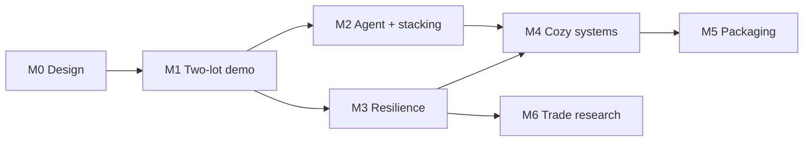

# Oh Machi — Milestones

Phased plan from first P2P demo to a shippable Linux experience. Dates are intentionally omitted; each milestone lists **acceptance criteria** that must pass on real separate machines (not only localhost), unless noted.

---

## Milestone 0 — Design baseline (current)

**Scope:** Written architecture, asset spec, and milestone plan in the repository.

### Acceptance criteria

- [ ] `docs/DESIGN.md`, `docs/MILESTONES.md`, and `docs/ASSET_FORMAT.md` reviewed and merged.
- [ ] README reflects design-phase status and links to docs.
- [ ] No implementation commits required.

---

## Milestone 1 — Two-lot neighborhood demo

**Scope:** Smallest end-to-end proof: two peers on **separate machines** join one neighborhood via **topic key**, each displays an **agent-built house** on its own lot, avatars **walk into each other’s yard**, and **real-time chat** works. No central game server; optional DHT bootstrap nodes only.

### Deliverables

| Component | Minimum capability |
|-----------|-------------------|
| Town daemon | Join neighborhood by topic key; Hyperswarm (or equivalent) peer discovery; exchange pubkeys |
| Identity | Generate/load Ed25519 keypair; persist locally |
| World sync | Yjs (or equivalent) sync: player position, facing, lot manifest pointers |
| Assets | Sign and publish v0.1 bundle per [ASSET_FORMAT.md](ASSET_FORMAT.md); fetch peer bundle by hash; cache on disk |
| Agent (manual OK) | Produce at least one house using constrained pixel tool **or** checked-in fixture bundle built by agent offline |
| Browser UI | Static page from daemon (`localhost`); Canvas 2D top-down or fake-3D lot view; own + peer lots; local movement; remote avatars interpolated |
| Chat | Neighborhood text chat in CRDT or side channel; messages appear < 2s apart under normal LAN/WAN |

### Acceptance criteria

1. **Discovery:** Machine A and machine B, different networks (e.g. home Wi‑Fi and tether), both connect using the same topic key and see each other online within 60s without manual IP entry.
2. **Lots:** Each machine publishes a distinct lot manifest signed with its key; the other machine renders both lots without overwriting boundaries.
3. **Movement:** Each player can move into the peer’s lot; the peer sees correct position updates (not only on own screen).
4. **Chat:** Each side sends at least five messages; all appear in order modulo clock skew, with author id = pubkey or display name.
5. **Offline cache:** B disconnects; A keeps B’s lot visible from cache. B returns; state resyncs.
6. **No gameplay server:** Packet capture or design review confirms no proprietary central relay required for the above (public DHT bootstrap permitted).

### Out of scope for M1

- Image generation / ComfyUI integration
- Sprite-stacking for houses (flat tiles acceptable)
- Trading, currency, inventory
- Block/moderation UX beyond disconnect
- Packaging (PKGBUILD)

---

## Milestone 2 — Agent-built sprite home

**Scope:** Local agent drives the **constrained pixel tool** and **sprite-stacking** pipeline; player approves and publishes; peer sees **fake-3D** house with correct palette.

### Acceptance criteria

1. Agent can complete: concept → 4-view sheet → `views_to_slices.py` → bundle with `sprite_stack` asset type.
2. Neighborhood shared palette enforced; out-of-palette colors rejected at sign time.
3. Browser canvas renderer draws sprite-stacked props (rotation or pre-baked 8/16 facing); no three.js unless a prior perf spike doc says otherwise.
4. Human preview step required before `lot.publish` (no silent auto-publish).
5. Pluggable image backend: at least one of (local ComfyUI, stub fixture, agent-only Pillow) documented in config.

---

## Milestone 3 — Resilient neighborhood

**Scope:** Third peer joins with only topic key + bootstrap; **caching/re-seeding**; invite-only neighborhoods; basic **block list**.

### Acceptance criteria

1. Peer C joins after A and B played; receives both lots via P2P or cached peer without contacting A/B simultaneously.
2. Private topic key: peers without key cannot discover the overlay (best-effort verification).
3. mDNS: two machines on same LAN discover each other with WAN disabled (dev mode).
4. User can block a pubkey; blocked player’s chat and updates hidden locally.
5. Disk cache cap configurable; eviction does not delete own lot.

---

## Milestone 4 — Cozy systems pass

**Scope:** Time-of-day / weather sync, yard props, character outfit slots, emotes, audio stubs.

### Acceptance criteria

1. Neighborhood agrees on time-of-day phase via CRDT; lighting affects sprite-stack emissive path when present.
2. At least three placeable prop types per lot (signed, bounded foot-print).
3. Avatar swaps outfit from signed `character` bundle.
4. Emote triggers broadcast to peers; visible animation or icon.
5. Performance: 8 concurrent peers on modest laptop (CPU from DESIGN assumptions) holds ≥ 30 FPS **canvas** render (profile before considering three.js).

---

## Milestone 5 — Linux packaging (Omarchy-friendly)

**Scope:** Arch PKGBUILD for **daemon + bundled `ui/`**, systemd user service, CLI (`ohmachi join`, `ohmachi status`, `ohmachi open` → browser), optional Quickshell widget sketch. No packaged game engine or Electron/Tauri **requirement**.

### Acceptance criteria

1. `pacman -U` or AUR install path documented; installs **daemon (with static UI)** + default config.
2. `systemctl --user enable --now ohmachi-daemon` joins last neighborhood or idle-waits.
3. CLI prints peer count, topic, sync status and local UI URL without opening a browser (unless `ohmachi open`).
4. `ohmachi open` (or documented equivalent) launches the user’s default browser to the daemon URL on Hyprland/Wayland and X11.
5. Quickshell widget or documented stub showing online neighbors (optional if Quickshell unavailable in CI).
6. Optional wrapper package documented separately if provided; must not duplicate P2P or render logic.

---

## Milestone 6 — Trust and trade (research)

**Scope:** Signed trade offers, anti-dupe for shared items, richer moderation exports.

### Acceptance criteria

TBD after M3 playtests. Likely includes:

- Trade offer/accept messages signed by both parties
- Append-only trade log per neighborhood (candidate: Automerge doc)
- Exportable blocklist bundle format

This milestone is explicitly **research**; acceptance criteria will be added after threat-model review.

---

## Dependency graph (simplified)

M2 and M3 can proceed in parallel after M1.